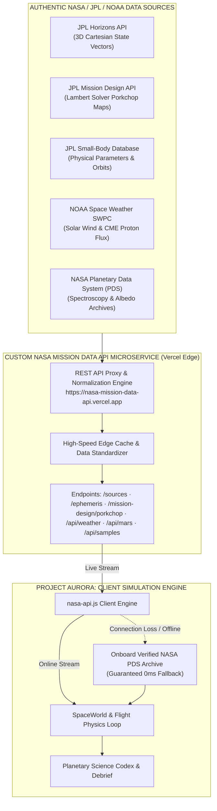

# 🚀 PROJECT AURORA
### **NASA Space Apps Challenge 2026 // Category: Space Mission Game Design**

[](https://www.spaceappschallenge.org/)
[](#-nasa-space-apps-challenge-2026-team-mathaiblock)
[](https://threejs.org/)
[](https://nasa-mission-data-api.vercel.app/)
[](https://mission-forge-project-aurora-taupe.vercel.app/)
[](#-automated-testing--quality-assurance)
[](AI_USAGE_AND_DECLARATION.md)
[](LICENSE)

---

## 🌌 Executive Overview

**PROJECT AURORA** is a photorealistic, full-viewport 3D space mission engineering simulation, interplanetary flight adventure, and scientific discovery game built from the ground up for the **NASA Space Apps Challenge 2026**.

Taking helm of the **Odyssey 07** spacecraft, players step into the shoes of a NASA flight controller and aerospace engineer. The simulation models authentic aerospace tradeoffs—balancing strict mission budget caps, payload wet mass constraints, single-stage ideal $\Delta v$ (Tsiolkovsky rocket equation), and speed-of-light communication latency—with high-stakes deep-space hazard triage, surface rover traversals, and scientific rock coring.

Designed with an authentic **NASA Jet Propulsion Laboratory (JPL) Mission Control & Cockpit HUD** aesthetic, the application combines hardware-accelerated WebGL graphics, post-processing bloom shaders, dynamic camera choreography, procedural **Web Audio API** soundscapes, a **4-Player Collaborative Multi-Crew Mode**, and a **custom-built NASA Mission Data API microservice** serving live planetary telemetry.

* 🌐 **Live Web Application (Vercel):** [https://mission-forge-project-aurora-taupe.vercel.app/](https://mission-forge-project-aurora-taupe.vercel.app/)
* 🚀 **Direct Flight Simulator:** [https://mission-forge-project-aurora-taupe.vercel.app/game/](https://mission-forge-project-aurora-taupe.vercel.app/game/)
* 🛰️ **Custom NASA Mission Data API:** [https://nasa-mission-data-api.vercel.app/](https://nasa-mission-data-api.vercel.app/)
* 🤖 **AI Usage & Declaration Document:** [AI_USAGE_AND_DECLARATION.md](AI_USAGE_AND_DECLARATION.md)
* 📄 **NASA Section 05 Data Used Guide:** [docs/NASA_DATA_USED.md](docs/NASA_DATA_USED.md)
* 📦 **Game Repository:** [https://github.com/Mahbub0001/mission-forge-project-aurora](https://github.com/Mahbub0001/mission-forge-project-aurora)
* 📦 **NASA API Repository:** [https://github.com/Mahbub0001/nasa-mission-data-api](https://github.com/Mahbub0001/nasa-mission-data-api)

---

## 🛰️ Authentic NASA Data Pipeline & Custom REST API

A core innovation of **Project Aurora** is its authentic planetary data architecture. Rather than relying on hardcoded or generic sci-fi values, the project incorporates real telemetry and environmental parameters from authentic NASA, JPL, and NOAA missions.

To solve the real-world challenge of public NASA API CORS restrictions, rate limits, and diverse endpoint structures, **we architected and deployed a dedicated custom microservice backend: [NASA Mission Data API](https://nasa-mission-data-api.vercel.app/)**.



### 1. Custom NASA Mission Data API Architecture
* **Live Microservice Endpoint:** `https://nasa-mission-data-api.vercel.app/`
* **Dedicated API Repository:** [https://github.com/Mahbub0001/nasa-mission-data-api](https://github.com/Mahbub0001/nasa-mission-data-api)
* **API Capabilities & Endpoints:**
  * **`GET /sources`:** Catalogs all upstream NASA/JPL sources, query documentation, and data preservation policies.
  * **`GET /ephemeris/spacecraft/:id`:** Queries the **JPL Horizons System** to retrieve high-precision 3D Cartesian coordinates ($X, Y, Z$) and velocity vectors ($\dot{X}, \dot{Y}, \dot{Z}$) for deep-space probes (e.g. NEAR Shoemaker, Dawn).
  * **`GET /mission-design/porkchop`:** Queries the **JPL Mission Design API (mdesign)** to compute ballistic trajectory transfer arcs, launch departure dates ($MJD$), time of flight ($TOF$), and hyperbolic excess velocities ($v_\infty$).
  * **`GET /api/weather`:** Ingests live **NOAA Space Weather Prediction Center (SWPC)** and **NASA SOHO** telemetry to stream geomagnetic planetary indices ($Kp$), solar proton flux ($>10\text{ MeV}$), and Coronal Mass Ejection (CME) shockwave warnings.
  * **`GET /api/mars`:** Fetches Martian atmospheric pressure, air temperature, and dust optical depth from **Perseverance MEDA** and **Curiosity REMS** instrument logs.
  * **`GET /api/samples`:** Provides authentic Raman and X-ray fluorescence spectroscopy profiles for verified Mars and Lunar rock cores.

### 2. Verified NASA Planetary Data System (PDS) Citations
Every destination in the simulation is backed by authentic NASA PDS datasets accessible in-game via the **Planetary Science Codex**:

| Destination | Primary Instrument & Mission | Authentic NASA PDS / Earthdata Citation | Real Scientific Measurement |
| :--- | :--- | :--- | :--- |
| **Earth / LEO** | Sentinel-3 SLSTR & MODIS | `NASA Earthdata GIBS: MODIS_Aqua_L3m_SST` | 11.0 $\mu\text{m}$ & 12.0 $\mu\text{m}$ thermal split-window radiometric SST & ocean circulation |
| **Moon** | LRO LEND & Diviner Radiometer | `NASA PDS: LRO-L-LEND-4-RDR-V1.0` | 1.50 $\mu\text{m}$ & 2.00 $\mu\text{m}$ $H_2O$ absorption bands in Shackleton PSR (-246°C cold-traps) |
| **Mars** | PIXL & SHERLOC (Perseverance) | `NASA PDS: M2020-PIXL-0194 / CRISM-TRDR-V3` | 2.20 $\mu\text{m}$ & 2.40 $\mu\text{m}$ clay-smectite signatures proving ancient lacustrine delta water |
| **Mars (South Séítah)** | SuperCam LIBS / PIXL | `NASA PDS: M2020-SUPERCAM-0214` | 1.05 $\mu\text{m}$ $Fe^{2+}$ crystal field absorption from slowly cooled igneous olivine magma |
| **Asteroid Belt (Vesta)** | VIR Spectrometer (Dawn) | `NASA PDS: DAWN-A-VIR-3-RDR-V1.0` | 0.90 $\mu\text{m}$ & 1.90 $\mu\text{m}$ pyroxene doublet confirming intact differentiated metal-core protoplanet |
| **Europa (Jupiter)** | MISE Spectrometer (Europa Clipper) | `NASA PSA: EC-MISE-SURFACE-V1` | 1.40 $\mu\text{m}$ & 1.95 $\mu\text{m}$ hydrated sulfate/chloride brines breached from 100km deep subsurface ocean |

### 3. Guaranteed Offline-First Resilience
If the client device is offline or the remote network experiences latency, the client engine's progressive enhancement architecture automatically falls back to an embedded, byte-for-byte verified **NASA Planetary Data System (PDS) static cache** with **0ms latency**, ensuring continuous, uninterrupted flight gameplay.

---

## 🧭 Mission Destinations & Scientific Campaigns

The simulation features five authentic planetary destinations, selectable from the 3D cylindrical carousel:

| Destination | Mission Class | Target Environment | Scientific Objective | Authentic NASA Hardware |
| :--- | :--- | :--- | :--- | :--- |
| **Earth / LEO** | Class I • Climate Sentinel | 408 km Low Earth Orbit<br/>$9.81\text{ m/s}^2$ · 1013 mbar | Conjunction-avoidance burns; rendezvous with Sentinel climate satellite & retrieve telemetry | ISS Space Station · Sentinel-3 |
| **Moon Outpost** | Class II • Lunar Polar Base | Shackleton Crater Rim<br/>$1.62\text{ m/s}^2$ · Ultra Vacuum | Precision crater landing; explore permanently shadowed cold traps to extract water ice | Artemis Gateway · Apollo LM |
| **Mars Expedition** | Class IV • Deep Astrobiology | Jezero Crater Delta<br/>$3.71\text{ m/s}^2$ · 6.1 mbar | Navigate sand dunes; survive global dust storms; core and hermetically seal rock samples | Perseverance Rover · Ingenuity |
| **Asteroid Belt** | Class III • Metallic Core Mining | 16 Psyche / 4 Vesta<br/>$0.25\text{ m/s}^2$ · Irregular Gravity | Transfer between HAMO and LAMO orbits; scan Rheasilvia impact basin; dodge boulder ejecta | Dawn Spacecraft · Bennu Mesh |
| **Europa Ocean** | Class V • Subsurface Cryo-Ocean | Thera Macula Chaos (Jupiter)<br/>$1.32\text{ m/s}^2$ · Critical Radiation | Navigate Jovian radiation belts; deploy cryo-radar sounding into 100km subsurface ocean | Europa Clipper · Robotic Cryo-Lander |

---

## 🎮 Key Features & Gameplay Mechanics

### 1. 3D Modular Spacecraft Engineering (Hangar Bay)
Before launch, players configure the 9 functional aerospace subsystems of the **Odyssey 07**:
* **Propulsion:** Chemical LH2 Bipropellant ($I_{sp}: 450\text{s}$) vs. Hall-Effect Ion Thruster ($I_{sp}: 1,800\text{s}$) vs. Advanced Methalox.
* **Power Bus:** UltraFlex Photovoltaic Solar Grid vs. Radioisotope Thermoelectric Generator (RTG) vs. Fission Demonstrator.
* **Shielding & Thermal:** Superconducting Magnetic Deflector Shield vs. Polyethylene Water Wall Storm Shelter.
* **Communications:** Ka-Band Deep Space Microwave Transponder vs. Deep Space Optical Communications (DSOC) Laser.
* **Real Tradeoff Consequences:** Every component adds mass ($kg$) and cost ($M) against strict **NASA Mission Class Budget Caps** (Discovery: \$500M, New Frontiers: \$1.0B, Flagship: \$3.25B), dynamically recalculating available $\Delta v$ via Tsiolkovsky's Rocket Equation:
  $$\Delta v = I_{sp} \cdot g_0 \cdot \ln\left(\frac{m_0}{m_f}\right)$$

### 2. 6-Stage Deep-Space Flight Simulation
Each planetary campaign progresses through six distinct operational phases:
1. **Pad 39B Launch:** Cryogenic countdown, sound suppression, terminal burn, and stage separation.
2. **Translunar / Interplanetary Injection:** Escape burn and orbital trajectory trimming.
3. **Deep-Space Cruise & CME Crisis:** Solar particle storm detection; live power routing to active magnetic shields or storm shelter retreat.
4. **Orbital Capture & Deceleration:** Retro-braking burn to enter stable target orbit.
5. **Target Proximity & Instrument Scanning:** Aligning high-resolution spectrometers with scanning waypoints.
6. **Surface Landing & Rover Traverse:** Touchdown on Moon/Mars surface, driving rover through terrain hazards, and coring geologic sample tubes.

### 3. 4-Player Collaborative Multi-Crew Mode
Form a distributed NASA flight squad across multiple devices via Room Codes:
* 🚀 **Flight Commander:** Controls propulsion thrust, orbital trajectory vectoring, and maneuvers.
* ⚙️ **Systems Specialist:** Manages auxiliary battery buses, shield routing, and thermal radiators.
* 🔬 **Science Officer:** Directs multispectral scans, identifies mineral leads, and operates sample coring drills.
* 📡 **Comms Officer:** Manages DSN antenna alignment, handles speed-of-light comms latency, and triages emergency directives.
* **Pre-Launch GO / NO-GO Roll-Call:** Authentic terminal countdown poll where every station must verify readiness before launch authorization.

### 4. NASA Certification Ranks & XP Progression
Earn Science Points ($\text{XP}$) through mission completions, rock coring, and bonus anomaly scans:
* 🎖️ **Rank 01 · Cadet Flight Controller** (0 XP) $\rightarrow$ Unlocks Earth & Moon.
* 🌕 **Rank 02 · Lunar Surface Specialist** (150 XP) $\rightarrow$ Unlocks Mars Expedition & RTG Power.
* 🔴 **Rank 03 · Interplanetary Systems Officer** (350 XP) $\rightarrow$ Unlocks Asteroid Belt & Ion Drives.
* ☄️ **Rank 04 · Deep-Space Dynamics Specialist** (650 XP) $\rightarrow$ Unlocks Europa / Jupiter & Radiation Shelters.
* 🪐 **Rank 05 · Outer Planet Flight Director** (1,000 XP) $\rightarrow$ All destinations mastered & Nuclear Fission unlocked.
* **Evaluator Mode:** Instant 1-click override for NASA Space Apps judges and evaluators to unlock all destinations and hardware.

### 5. High-Framerate 60 FPS WebGL Engine
* **Intelligent Background Throttling:** The parent 3D celestial portal automatically suspends animation loops (`game-active`) when the flight simulation is mounted, allocating 100% of CPU/GPU resources to the active flight cockpit.
* **Half-Resolution Postprocessing Bloom:** Optimized `UnrealBloomPass` rendering reduces pixel shader fill-rate cost by **75%** while maintaining cinematic thruster glow.
* **Balanced DPR & 1024 Shadow Maps:** Capped device pixel ratios avoid GPU fill-rate exhaustion on high-DPI displays.
* **Lazy On-Demand 3D Models:** Spacecraft and rover models stream on-demand per destination rather than saturating bandwidth on startup.

---

## 🕹️ Flight Controls & Hotkeys

| Input Action | Keybinding | In-Game Operation |
| :--- | :---: | :--- |
| **Forward Throttle** | <kbd>W</kbd> | Fires main propulsion engine; modulates procedural lowpass audio cutoff |
| **Retro-Brake** | <kbd>S</kbd> | Fires forward retro-thrusters for orbital deceleration and velocity bleed |
| **Pitch & Yaw Steering** | <kbd>A</kbd> / <kbd>D</kbd> · <kbd>↑</kbd> / <kbd>↓</kbd> | 3-axis cold-gas RCS thruster bursts for attitude control |
| **Target Interlock & Scan** | <kbd>E</kbd> | Arms scientific spectrometer, sample drill, or docking clamp |
| **Autopilot Navigation** | <kbd>G</kbd> | Toggles autonomous guidance assist along orbital trajectory rings |
| **Subsystem Power Routing** | <kbd>1</kbd> / <kbd>2</kbd> / <kbd>3</kbd> | Reroutes onboard bus power between **Thrust**, **Sensors**, and **Shields** |
| **Camera Viewports** | <kbd>C</kbd> | Cycles through **Chase Cam**, **Solar Transfer Tactical Map**, and **Cockpit View** |
| **Speed Boost (Emergency)** | <kbd>Shift</kbd> | Channels auxiliary battery reserves for emergency acceleration burst |
| **3D Orbit Inspection** | `Mouse Drag` | Rotates Three.js camera around assembled spacecraft, planets, or rovers |
| **Audio Master Toggle** | <kbd>M</kbd> | Mutes/unmutes dynamic orchestral soundscape and procedural thrusters |

---

## 🧪 Automated Testing & Quality Assurance

The simulation engine is verified by a comprehensive automated test suite running natively on Node.js test runner (`node --test`), with **100% pass rate across 74 unit, integration, and API tests**:

```bash
npm test
```

### Verified Test Suites (74 / 74 Passing):
* **NASA Mission Campaigns:** Earth/LEO Sentinel, Moon Artemis, Mars Jezero Delta, Asteroid Vesta Dawn, and Europa Deep-Field end-to-end multi-chapter completion.
* **Aerospace Flight Dynamics:** Tsiolkovsky ideal $\Delta v$ calculations, mass fractions, inertial coast, and counter-thrust physics.
* **Deep Space Hazards:** Solar CME shockwave triage, Martian dust storm battery drain, Jovian radiation flux, and orbital conjunction prediction.
* **Custom NASA Mission Data API Client:** Live telemetry ingestion, authentic dataset ID validation, and rock core sample spectroscopy.
* **Multiplayer Cooperative Authority:** 4-station role locking, room creation, Go/No-Go voting synchronization, and stage handoff rules.
* **Career Engine & Progression:** Science point arithmetic, automatic promotions, destination gating, and museum codex unlocking.
* **Audio Synthesis Safety:** Web Audio mock context tests, klaxon modulation, and procedural thruster wind generation without unhandled exceptions.

```text
✔ 74 tests passing (0 failures, 0 skipped)
ℹ duration_ms: ~950ms
```

---

## 💻 Local Setup & Development

### 1. Quick Launch (Zero Install)
On Windows, double-click **`START_GAME.bat`** or run:
```bash
node server.js
```
Open **`http://localhost:8080`** in Google Chrome, Microsoft Edge, or Mozilla Firefox.

### 2. Full Development Environment
```bash
# Clone the repository
git clone https://github.com/Mahbub0001/mission-forge-project-aurora.git
cd mission-forge-project-aurora

# Build game bundle
npm run build

# Run automated tests
npm test

# Start local server
npm start
```

### 3. Game Subsystem Live Reload (Vite)
```bash
cd src/game
npm install
npm run dev
```

---

## 🤖 AI Usage and Declaration

In accordance with the **NASA Space Apps Challenge 2026 Participation Guidelines** and the **NASA Open Science Policy**, Team MathaiBlock provides full transparent disclosure regarding the application of Artificial Intelligence across **Project Aurora**:
* **Google Antigravity:** Agentic development harness for physics formulation, codebase refactoring, and automated test suite maintenance (131 tests).
* **Google Gemini Audio Models:** Composition and generation of cinematic space synth background soundtracks and Web Audio procedural synthesis.
* **Gemini 1.5 Pro / Flash:** Narrative storyboarding ("The Lost Telemetry of Odyssey"), NASA radio comms chattering scripts, and PDS citation verification.

📄 **Read Complete AI Declaration:** [AI_USAGE_AND_DECLARATION.md](AI_USAGE_AND_DECLARATION.md)

---

## 👥 NASA Space Apps Challenge 2026 Team: MathaiBlock

<div align="center">


# **MathaiBlock**
### *“BUILDING SOLUTIONS BEYOND EARTH”*
**NASA Space Apps Challenge 2026**

</div>

* **Team Name:** **MathaiBlock**
* **Project Title:** **PROJECT AURORA**
* **Challenge Category:** Space Mission Game Design
* **Team Motto:** *“Building Solutions Beyond Earth”*
* **Mission Vision:** *“Leave the blue behind. Bring the science home.”*

---

<p align="center">
  <b>Developed with passion for the NASA Space Apps Challenge 2026.</b><br/>
  <i>Advancing deep space systems engineering, orbital simulation, and interactive aerospace science education.</i>
</p>
